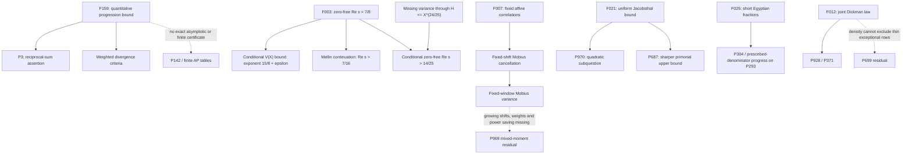

# What the new pieces unlock

For the subsequent local proofs and their verification boundaries, see
[current findings](CURRENT_FINDINGS.md), the [focused proof sprint](research-sprint/README.md),
and the [later arithmetic and formal bridge](research-next/README.md).
The 133-edge overlay below retains its original external and conditional scopes;
local follow-through does not silently promote those edges.

Research analysis of OpenAI's October 6 collection against the atlas at
`a21acb5`. External sources remain pinned to
`adc7f1241b42e322a6451854ab7e4b4c146bf78a`.
**The derivations below are conditional on the cited external statements.**
They are informal mathematical arguments. Four central transfers have an
[independent model review](swarm/analytic-audit.md); that is not an external-proof
audit, Lean rebuild, human review, current-record claim, or canonical status change.

## 1. What the graph actually knows

The production graph has no node referencing `openai/math`: the preceding
update deliberately added a source catalogue without changing the production
graph. Its 122 `same_family` edges are metadata connections, not implications.
For example, `P3` shares sequence nodes with `P139`, `P140`, `P142` and `P201`;
the graph does not prove that resolving one resolves all five.

The separate [connections.json](connections.json) records the proposed
mathematical connections with explicit scopes and missing hypotheses. It is
not read by the production graph or status machinery. `external_statement_match`
means the published statement matches the specified question; `conditional_derivation`
means the argument is supplied here assuming its inputs; `declared_dependency`
means a manuscript explicitly invokes another source result; `candidate` and
`blocked_transfer` mean no implication has been established.



Solid arrows carry the conditional or externally reported meanings above,
not a local certification. Dotted arrows deliberately mark a missing transfer.

## 2. Direct targets overlooked by the first thematic crosswalk

| Source | Exact atlas contact | What the statement would settle or improve | What it does not settle |
|---|---|---|---|
| F159 | P3 | Every divergent reciprocal-sum set contains progressions of every finite length. | P142's asymptotic equivalent; exact r_k(N) cells. |
| F021 | P970 | The quadratic subquestion, with h(k) = O(k²/(log log(3k))²). | The full order of h(k), or an explicit constant for computing table cells. |
| F025 | P304 | The order of the worst shortest Egyptian-fraction length: N(b) = Θ(log log b). The paper explicitly identifies Problem 304. | The smallest length for a specified small numerator/denominator. |
| F025 | P293 | The paper's prescribed-denominator corollary gives log log v(k) = Θ(k), with stated lower and upper slopes. It explicitly identifies Problem 293. | A limiting slope, an exact v(k), or every stronger formulation of the problem. |
| F012 | P928 | The ordinary joint density equals the product of the Dickman marginals. | Uniformity in moving smoothness parameters. |
| F012 | P371 | Natural density 1/2 for either ordering of consecutive largest prime factors. | The longest exceptional run or a bound for every individual pair. |
| F028 | P952 | No infinite injective bounded-step Gaussian-prime walk; the scope document reports a uniform finite component bound for each fixed step bound. | An explicit numerical component-size function. |

These matches use the pinned manuscript introductions/scopes and atlas
statements or gap-map definitions. The P304/P293 manuscript correspondence is
stronger than the initial unit-fraction-tag suggestion for P327. P970's
arbitrary-prime-set theorem is stronger than a theorem only about primorials.
All seven IDs remain in their existing canonical state pending the normal
source and proof review. No claim of seven fully resolved atlas problems is made.

## 3. A concrete transfer into the RH / P969 lane

Let

\[
 E(x)=\sum_{n\le x}\mu(n)^2-\frac{x}{\zeta(2)},\qquad
 V(X)=\int_1^X |E(x)|^2\,dx.
\]

The atlas already proves a conditional Mellin/Plancherel interface in
[ANALYTIC_TARGET.md](../astra-rh-969-20260912/ANALYTIC_TARGET.md).
The missing RH-scale conclusion there is V(X) = O_epsilon(X^(3/2+epsilon)).

**Conditional deduction.** Assume the F003 zero-free conclusion for zeta.
Then, for every epsilon > 0,

\[
 \boxed{V(X)\ll_\epsilon X^{15/8+\epsilon}.}
\]

Equivalently the root-mean-square error on [1,X] is at most
O_epsilon(X^(7/16+epsilon)). This is an intermediate bound obtained by
substituting a new input into an existing atlas argument. It is not the
quarter-power pointwise conjecture, an RH proof, or a novelty claim.

### Derivation and its analytic hypotheses

More generally suppose 1/2 ≤ q < 1 and zeta has no zero in Re(s) > q.
For each fixed delta, eta > 0 the classical logarithm argument gives

\[
 1/\zeta(\sigma+it)\ll_{\delta,\eta}(1+|t|)^\eta
 \quad(\sigma\ge q+\delta).
\]

Here is why zero exclusion supplies growth control, rather than just
continuation. At large height choose a disk centered at 2+it contained in
Re(s) > q, avoiding the pole at 1. A branch of log zeta exists on the disk.
Polynomial growth of zeta and Borel–Carathéodory bound its logarithm by
O(log |t|) on a slightly smaller disk. On a fixed inner disk in Re(s) > 1,
the Euler logarithm is O(1). Three-circles interpolation at any fixed
interior line gives log zeta = O((log |t|)^r) with r < 1, hence both
zeta and its reciprocal are |t|^o(1) there. The margin from q is essential;
no boundary estimate or uniformity as delta tends to zero is asserted.
The F003 paper also spells out this disk argument in its
`lem:logarithmic-control` for its Hecke setting. For this deduction the
same classical argument is applied directly to the Riemann zeta function.

Initially in Re(s) > 1,

\[
 F(s)=\int_1^\infty E(x)x^{-s-1}\,dx
     =\frac{\zeta(s)}{s\zeta(2s)}-\frac{1/\zeta(2)}{s-1}.
\]

The right side is holomorphic in Re(s) > q/2: the pole at 1 is subtracted;
the denominator's pole at 1/2 is a removable zero of its reciprocal.
Fix q/2 < a < 1 and b > 1. Convexity for the numerator and the reciprocal
bound yield, uniformly on a ≤ Re(s) ≤ b at large height,

\[
 F(s)\ll_{a,b,\eta}|t|^{-(1+a)/2+\eta}+|t|^{-1}.
\]

Choose 2 eta < a. This is square integrable on the line Re(s) = a.
As in the atlas proof, pair with entire transforms of compactly supported
smooth tests and move the contour from b to a. No poles are crossed and
the horizontal integrals vanish. This identifies the inverse Fourier
transform with the **original** error, not merely a meromorphic continuation:

\[
 J_a:=\int_1^\infty |E(x)|^2x^{-2a-1}\,dx
   =\frac1{2\pi}\int_{\mathbb R}|F(a+it)|^2\,dt<\infty.
\]

Thus V(X) ≤ X^(2a+1) J_a. Taking a = q/2 + epsilon/2 gives
V(X) = O_epsilon(X^(1+q+epsilon)); take small epsilon first, with larger
epsilon following immediately. Substituting q = 7/8 gives 15/8.
The same substitution gives pole-free continuation to Re(s) > 7/16.

| Input | Energy exponent from this interface | Missing to reach the atlas RH target |
|---|---|---|
| Elementary E(x) = O(sqrt(x)) | 2 | Cancellation beyond the elementary square-divisor bound |
| Reported q = 7/8 zero exclusion plus classical growth argument | 15/8 + epsilon | A further exponent reduction of 3/8, with every positive epsilon |
| RH, q = 1/2 | 3/2 + epsilon | This is the target equivalence, not an available unconditional input |

These are upper exponents, not exact error sizes or percentages of an RH proof.
The F003 paper itself says RH remains open.

### Another composition: an existing zero-free region completes a strip

The atlas's [MELLIN_TRANSFER.md](../astra-rh-crt-20260912/MELLIN_TRANSFER.md)
says the specified squarefree increment variance through H ≤ X^theta gives
continuation to Re(s) > a = 1 − 3 theta/4. For 1/4 < a < 1/3 it excludes
zeros only in the invariant **open strip** 2a < Re(rho) < 2 − 4a.

If a separate result excludes Re(rho) > q and q < 2 − 4a, the two
regions overlap and their union excludes **every** Re(rho) > 2a. With
q = 7/8 this requires theta > 23/24, strictly. For example:

\[
 \theta=24/25 \Longrightarrow a=7/25,\quad
 (2a,2-4a)=(14/25,22/25),\quad 7/8<22/25.
\]

Hence F003 **plus the still-missing variance hypothesis at theta = 24/25**
would give zero exclusion for Re(s) > 14/25 = 0.56. Endpoint equality at
theta = 23/24 is insufficient: zeros on Re(s) = 7/8 are not excluded by F003.
Repeatedly applying this argument with the same fixed theta cannot reach RH.
Our current assembled variance range is only 4/7 − epsilon, far below this
requirement. The new input does not supply the missing variance estimate.

## 4. What the correlation result genuinely supplies

F007 bounds Liouville correlations for **fixed nonproportional affine forms**:

\[
 \sum_{n\le X}\lambda(an+b)\lambda(cn+d)
 =O_{a,b,c,d}\bigl(X/(\log X)^u\bigr),\quad u>0.
\]

Its introduction explicitly disclaims uniformity for growing coefficients;
the general multiplicative-function conclusion is qualitative. There is,
however, a useful conditional consequence one can derive without such uniformity:

\[
 \sum_{n\le X}\mu(n)\mu(n+h)=o_h(X) \quad(h\ge1\text{ fixed}).
\]

**Proof of the transfer.** For fixed z, put
S_z(n) = product over primes p ≤ z of (1 − 1_{p² divides n}).
Both S_z and mu² are bounded by one; they differ only if a square of a
prime greater than z divides n. Its count up to X is at most

\[
 \sum_{z<p\le\sqrt X}(X/p^2+1)=O(X/z+\sqrt X).
\]

Use mu(n) = lambda(n) mu²(n). Replacing the two squarefree indicators by
S_z changes the normalized correlation by O(1/z) + o(1). For fixed z,
S_z(n) S_z(n+h) is periodic modulo the fixed product of p². Partition by
its finitely many residue classes. Each surviving sum is a Liouville
correlation along two fixed affine forms of determinant equal to the modulus
times h, hence nonzero. F007 makes every such sum o(X). First let X tend
to infinity with z fixed, then let z tend to infinity. No growing-modulus
estimate, effective convergence rate or logarithmic saving for mu is claimed.

Expanding a square gives a further consequence for each fixed integer H:

\[
 \boxed{\lim_{X\to\infty}\frac1X\sum_{n\le X}
   \left|\sum_{h=1}^H\mu(n+h)\right|^2=\frac{H}{\zeta(2)}.}
\]

The diagonal uses the elementary density of squarefree integers; the
finitely many off-diagonal terms vanish by the preceding transfer.

This is a genuine signed averaging interface, but the limit order is crucial.
It does not allow H = X^theta. Moreover, P969's open object is

\[
 I(T,D)=\int_T^{2T}\left|\zeta(1/2+it)
        \sum_{D\le d<2D}\mu(d)d^{-1-2it}\right|^2dt,
 \qquad D\asymp T^{5/6},
\]

with a desired fixed power saving below T^(1/3), uniformly across masks,
heights and nearby lengths. A logarithmic saving for fixed affine Liouville
pairs neither handles the zeta weight and square frequencies nor pays the
growing family of shifts. This is where a proposed F007 → RH edge stops.

## 5. A second clean transfer: uniform sieves to primorial gaps

Let P(z) be the product of primes at most z and let j(m) be the maximal
gap between integers coprime to m (equivalently the least interval length
guaranteeing a coprime integer). From F021 and the prime number theorem,

\[
 j(P(z))\le h(\pi(z))
 \ll \frac{z^2}{(\log z)^2(\log\log z)^2}.
\]

This gives a precise new asymptotic upper-bound input for P687's primorial
surface, conditional on F021. The graph's old O(z²) bound is superseded at
this level, though its exact next cell is not evaluated. The numerical
constant is not supplied by the paper.

For P854, write a(k) for the least missing positive even gap among consecutive
integers coprime to the product P_k of the first k primes. All such gaps
are even and at most j(P_k), so

\[
 a(k)\le j(P_k)+2\le h(k)+2
      \ll k^2/(\log\log(3k))^2+2.
\]

This is an upper bound, not an assertion that every smaller even gap occurs.
P860's requirement for **distinct representatives** is a different quantified
problem; shared Jacobsthal sequence tags do not provide a Hall-type matching
argument. Do not propagate this result to P860 as a solution.

The potentially reusable method inside F021 is its comparison of prescribed
residue-class counts with a reference sieve: discrepancy leads to rational
alignment, variance narrows the exceptional endpoints, and stopped branches
recover survivors. That resembles the atlas's actual-interval versus
product-phase deficit. Transferring it to squarefree variance would still
require prime-square moduli, centered second moments, growing-H uniformity,
and summable endpoint/tail losses. This remains a method candidate.

## 6. False joins and the more useful replacements

- **F012 → P699:** the former gives fixed-parameter density statements; the
  latter already confines failures, for fixed i, to only
  O_i(X^(1/3) (log X)^pi(i)) candidate n. An o(X) exceptional set can contain
  that entire residual. Even a uniform O(X^(1−delta)) error would only reach
  its counting scale when delta > 2/3, and would still not prove emptiness
  without an implication connecting a failure to the counted event. A more
  promising input is an estimate conditioned on the actual smooth-part
  divisibilities S_0, S_1, S_2, or an obstruction to the positional system.
- **F025 → P327:** short representations permit unrestricted denominators
  and many terms. P327 forbids specified two-term identities inside one set.
  A transfer needs a theorem forcing an activated forbidden pair or a
  cross-fiber deficit; it does not follow from the length bound.
- **F170 → finite Ramsey certificates:** fixed-s asymptotics as t tends to
  infinity do not settle R(5,5), nor the s = 3 lane. Constants and thresholds
  matter before an asymptotic estimate can decide a finite cell.
- **F189 → P159:** the cycle–clique formula requires m ≥ n. P159 studies
  C_4 against K_n with n growing, so the theorem does not apply in that
  regime. The notation looks close but the parameter range is reversed.
- **F159 → P142:** a stretched-exponential upper bound is not an asymptotic
  equivalent. For k = 3, bounds of this qualitative shape already existed;
  the new all-fixed-k theorem must not be advertised as a new k = 3 shape.
  Its reusable consequence is summability: dyadic block bounds imply finite
  harmonic mass for k-AP-free sets, and even convergence with every fixed
  logarithmic weight. This links quantitative density to sparse sets.
- **F020 → P969:** squarefree values of an irreducible quartic are not the
  variance of squarefree integers in moving intervals. The polynomial,
  averaging variables, and required error term all differ.

## 7. Work that is now well targeted

1. **Audit and register the direct statement matches first.** P3, P304,
   P371, P928 and P952 deserve theorem-to-problem verification; P970 and P293
   require explicit subquestion labels. Start from actual solution modules,
   Comparator configurations and dependency axioms, not catalogue checkmarks.
2. **Audit the F003 → squarefree-energy transfer.** The argument above is short,
   reuses an existing atlas proof and specifies its growth input. Register
   J_(7/16+delta), not the RH-scale J_(1/4+delta), if that review succeeds.
3. **Audit F021's uniform theorem and its primorial corollary.** This can update
   an asymptotic surface without pretending a search has found a new exact gap.
4. **Extract F007's quantitative dependence before using it in the mixed moment.**
   The next question is whether its proof can control growing forms, square
   frequencies and weights with enough savings. The present theorem does not.
5. **Study F021's discrepancy mechanism against the CRT defect operator.**
   This is the clearest structural research lead: both must pass from a
   favorable reference model to the actual arithmetic sample. The common
   obstacle is explicit enough to formulate a transfer lemma and test its
   hypotheses, rather than launch more brute-force computation.

The immediate gain is a changed research agenda and several exact conditional
interfaces. RH, the P699 residual, P327's extremal density and the frozen finite
tables retain their specific missing obligations.

## 8. What the graph swarm added

Three specialist agents covered number theory, combinatorics/geometry, and an
independent analytic review, followed by a second source-inspection wave.
The root also scanned all 372 family titles and searched the 665 licensed
local statements. This is broad discovery coverage, not a proof audit of all
722 manuscripts. The atlas has 556 link-only records, so a text search alone
necessarily misses some targets. P978 was found by following the formal-source
reference behind one such record.

The reproducible [overlay](connections.json) has **133 scoped connections**:
27 statement matches, 29 conditional deductions, 17 candidates, one declared
dependency and 59 blocked transfers, across 55 source families and 93 problem IDs.
These are connection counts, not solved-problem counts. The overlay collects the typed edges; its
counts are generated by [build_connections.py](build_connections.py). Repeated
matches and independent reviews are retained as supporting provenance rather
than counted as separate discoveries. The original production graph is
unchanged. Each edge includes its scope, missing hypotheses and primary links.
The separate specialist reports supply the detailed arguments and source hashes:

- [Number theory](swarm/number-theory.md): totient multiplicity, distinct values,
  least preimages, prime gaps, smoothness, polynomial squarefreeness and waiting times.
- [Combinatorics and geometry](swarm/combinatorics.md): progression and Ramsey
  bounds, distances, coloring, graph decompositions, and finite algorithmic tools.
- [Independent analytic review](swarm/analytic-audit.md): all four central
  transfers, Littlewood polynomials, higher power-free energies, fractal distances,
  discrepancy and precise failures of uniformity.

### Newly located theorem-to-problem contacts

These supplement the first table. A row can be a full statement match,
a subquestion, or a bound improvement; those meanings must not be collapsed.

| Cluster | Contacts | Scope of the externally reported match |
|---|---|---|
| Totients and primes | F011 → P821; F013 → P431; F024 → P416; F026 → P968 | Near-maximal totient multiplicity; no nontrivial additive decomposition of primes; regular variation of the totient-value count; positive-density prime-ratio increases. |
| Polynomial values | F020 → P978(ii),(iii) | Corrected local-obstruction statement and infinitely many squarefree values of n^4+2; not the already-disproved version allowing fixed divisors. |
| Arithmetic Ramsey | F160 → P138; F164 → P172 | Superexponential van der Waerden growth; finite monochromatic subset sums and products. |
| Graph Ramsey and structure | F171 → P181; F172 → P174; F181 → P184; F184 → P802; F189 → P551 | Linear hypercube Ramsey bound; Euclidean Ramsey classification; linear cycle/edge decomposition; sharp-order sparse independence bound; cycle–clique formula in its stated regime. |
| Finite geometry | F166 → P1083; F167 → P90; F156 → P505; F158 → P508 | Fixed-dimensional distinct-distance lower bound; improved unit-distance upper exponent; dimension-nine Borsuk counterexample; plane chromatic interval 6 to 7. These are different kinds of progress. |
| Restricted regimes | F084 → P120; F170 → P986; F191 → P507 | Geometric-sequence subcase; fixed-clique off-diagonal asymptotics; Heilbronn lower-bound power improvement. Full parent questions need not be settled. |
| Fourier analysis | F076 → P1150 | Real-sign ultraflat polynomials negate a fixed universal gap above the Parseval scale, after the degree/length conversion. |

The selected F191 Comparator's gain is about 7.21 × 10^(-237) in the exponent,
and its quantifier is an unbounded subsequence. The manuscript states a stronger
all-large-cardinalities version. This is an instructive example of a strict
asymptotic gain that does not imply an accessible finite improvement.

### Cross-domain deductions with short, inspectable bridges

**Odd cycle lengths acquire arithmetic structure.** The existing P57 theorem
says the odd cycle lengths of an infinite-chromatic graph have divergent
reciprocal sum. F159 therefore forces arbitrarily long arithmetic progressions
among those lengths. F182's power-saving square-difference-free bound separately
forces two such lengths to differ by a positive square. Since both lengths are
odd, that square is even. Neither conclusion requires the cycles to share
vertices. The two short summability arguments are in the combinatorics report.

**A marginal distribution becomes a joint distribution.** For square-product
waiting times t_n, an existing theorem gives the same marginal law as the
largest prime factor. Marginals alone do not identify joint laws. The missing
bridge is supplied by t_n ≥ P+(n) outside a density-zero set: consequently the
threshold events differ by density zero, allowing F012's joint law to transfer.
For fixed 0<a,b<1 this gives density rho(1/a)rho(1/b) for
`t_n <= n^a` and `t_(n+1) <= (n+1)^b`. The number-theory report proves every step,
including why the blanket inequality is false for squares.

**Totient counts now constrain least preimages.** F024 supplies a positive
proportion of values at most x whose first preimage lies between x and 2x.
Thus, writing Vprime(x) for the number of distinct totients attained by inputs
at most x, it gives `liminf V(x)/Vprime(x) > 1`. This does not establish P417's
limit. The least-preimage ratio question P51 remains expressly unresolved by
the source, despite the neighboring multiplicity theorem.

**Fractal dimension feeds a distance theorem.** Under F148's precise
no-exact-overlap hypotheses, a self-similar K with similarity dimension >1/2
has Hausdorff dimension >1/2. A product Frostman measure puts K × K above
planar dimension one; F073 then gives a positive-measure distance set. This
is an actual composition of theorem hypotheses, with no finite-distance
certificate or critical-dimension conclusion smuggled in.

**A counting theorem becomes an arithmetic assignment tool.** For a fixed
divisibility-assignment instance in P710 or P860, put one unit-demand row per
obligation, one unit-capacity column per candidate integer, and a dummy row
absorbing unused integers. Forbid inadmissible cells. The resulting 0/1
contingency tables correspond exactly to injective assignments, so F115's
claimed approximation algorithm estimates their number. It still needs Hall
inequalities to establish existence for every interval. This is an algorithmic
application with an explicit reduction, not a universal existence proof.

**There is a declared number-theory-to-algorithms dependency.** F142's
polynomial-factorization manuscript explicitly invokes the uniform Hecke
zero-free theorem in the primitive-roots companion F029. That is recorded as
a source-declared dependency. It does not make F142 an integer-factorization
algorithm or establish the necessity of that prerequisite. The source's
internal numeric labels must not be confused with catalogue family IDs.

**Autocorrelation provides a common language, with a real boundary.**
F076's flat sign polynomials imply unbounded binary merit factors through
`integral |P|^4 = N^2 + 2 sum C_h^2`. F007 gives cancellation at each fixed
Liouville lag. The former controls a sum over growing lags; the latter does not.
This identifies the missing uniform estimate rather than equating the two results.

## 9. The research priorities implied by the connections

The highest-value next action is **proof dependency review**, especially where
a short transfer would feed an existing lane. The overlay does not turn
manuscript availability into a proof acceptance signal.

1. **Audit statement-aligned targets.** P821/P431/P416/P968, P3, P1150 and the
   scoped P978 parts now have exact source interfaces. Compare actual solution
   modules, target declarations and dependency axioms before any status proposal.
2. **Audit shared analytic prerequisites once, then reuse the result.** F003
   would feed squarefree global energy, every fixed r-free analogue, and fixed
   coprime progression energies. Constants remain modulus dependent. This is a
   high-fan-out audit target, even though it does not close short-interval variance.
3. **Treat quantifier gaps as research tasks.** Growing shifts for F007,
   conditioned rare events for F012/P699, prime-square second moments for the
   F021/CRT transfer, and a forced forbidden pair for F025/P327 are distinct
   obligations. More headline theorems do not automatically supply them.
4. **Separate existence tools from finite witnesses.** A stronger asymptotic
   bound can change the search landscape without evaluating a table cell.
   Randomized algorithms can propose witnesses; accepted finite claims still
   need their exact combinatorial or arithmetic verification.
5. **Use source scope as graph data.** The manuscript, selected Lean statement,
   Comparator challenge, executed solution, and accepted community result are
   different evidence objects. Their differences are particularly visible in
   F026, F084, F126, F130, F157, F191 and F235.

To reproduce or query the overlay:

```sh
python3 experiments/openai-math-20261006/build_connections.py --check
python3 experiments/openai-math-20261006/build_connections.py --target P969
python3 experiments/openai-math-20261006/build_connections.py --target P841
```

## Sources and inspection depth

[connection-sources.json](connection-sources.json) records exact source URLs,
hashes and the selected sections used here. Full source files were downloaded
to scratch for navigation; reading introductions, stated results, and selected
analytic lemmas is not a full audit of hundreds of manuscript pages.
No external code, Lean build or Comparator run was executed for this analysis.

- [F003 paper source](https://github.com/openai/math/blob/adc7f1241b42e322a6451854ab7e4b4c146bf78a/preprints/The-Quasi-Riemann-Hypothesis-September-30-2026/build/paper.tex): `thm:main`, `lem:logarithmic-control`.
- [F007 introduction](https://github.com/openai/math/blob/adc7f1241b42e322a6451854ab7e4b4c146bf78a/preprints/Ordinary-two-point-correlations-of-multiplicative-functions-September-24-2026/build/introduction.tex): `thm:q-affine`, coefficient-uniformity limitation.
- [F012 introduction](https://github.com/openai/math/blob/adc7f1241b42e322a6451854ab7e4b4c146bf78a/preprints/The-joint-Dickman-law-for-consecutive-integers-September-24-2026/build/sections/introduction.tex): joint law, ordering, fixed-parameter limits.
- [F021 introduction](https://github.com/openai/math/blob/adc7f1241b42e322a6451854ab7e4b4c146bf78a/preprints/A-quadratic-bound-for-Jacobsthals-function-September-25-2026/build/sections/introduction.tex): `thm:main`, `thm:survivors`, proof outline and constants.
- [F025 introduction](https://github.com/openai/math/blob/adc7f1241b42e322a6451854ab7e4b4c146bf78a/preprints/Short-Egyptian-fractions-September-25-2026/build/introduction.tex): `thm:main`, `cor:prescribed`, P304/P293 references.
- [F159 introduction](https://github.com/openai/math/blob/adc7f1241b42e322a6451854ab7e4b4c146bf78a/preprints/Quasipolynomial-Bounds-for-Arithmetic-Progressions-September-23-2026/build/sections/00-introduction.tex): quantitative bound and summability argument.
- [F028 scope](https://github.com/openai/math/blob/adc7f1241b42e322a6451854ab7e4b4c146bf78a/lean/docs/028.md), [F170 scope](https://github.com/openai/math/blob/adc7f1241b42e322a6451854ab7e4b4c146bf78a/lean/docs/170.md), [F189 scope](https://github.com/openai/math/blob/adc7f1241b42e322a6451854ab7e4b4c146bf78a/lean/docs/189.md): exact domains.
